# EventSphere

EventSphere manages campus venue hire, event ticketing, waitlists, and QR check-in in a University of Vavuniya setting. It uses **Python 3.11+ / FastAPI**, SQLAlchemy, Pydantic, PostgreSQL on Render, SQLite locally, and Jinja, Bootstrap, and JavaScript.

Payments and refunds are simulated. Each successful booking records a payment reference and issues tickets without charging money or collecting card details.

The sample listings use venue names from published [University of Vavuniya](https://www.vau.ac.lk/workshop-on-university-research-grants-and-associated-procedures/), [Faculty of Technological Studies](https://fts.vau.ac.lk/index.php/workshops/), and [Faculty of Business Studies](https://www.vau.ac.lk/workshop-on-communication-skills-2023/) event notices. Dates, capacities, ticket quantities, and hire rates are sample values.

## Screenshots

These screenshots use local sample accounts for Vishnu (admin), Tharan (staff), and Thaksi and Nixon (attendees). The sample events include the ICT Society Workshop and Faculty Research Seminar.

<details>
<summary>Sign-in and event browsing</summary>

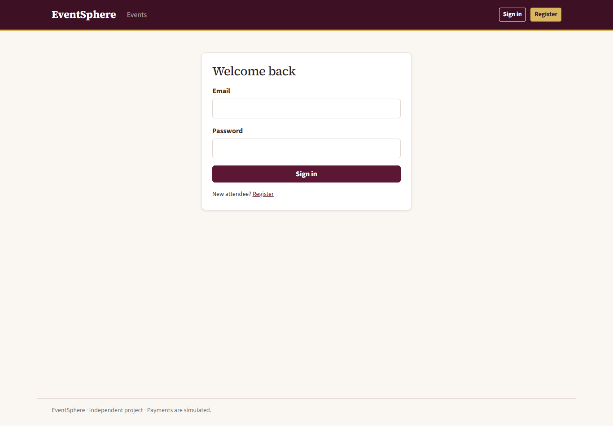

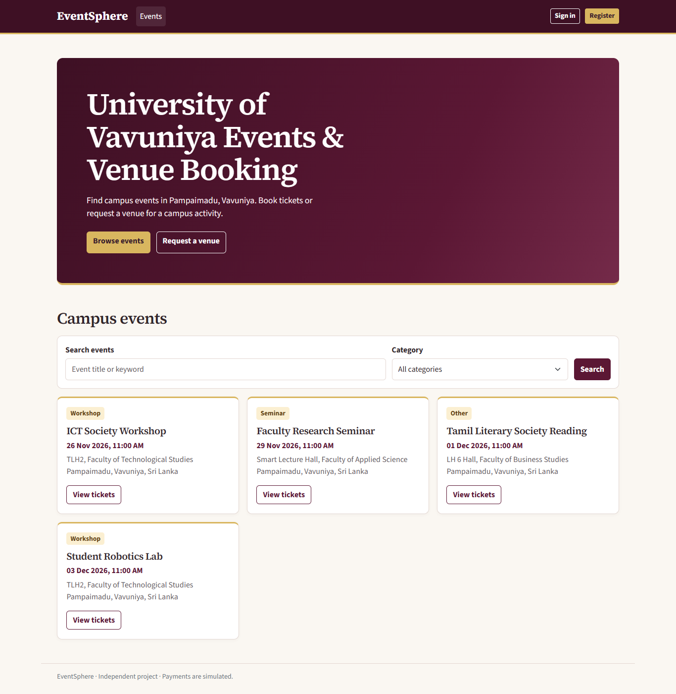

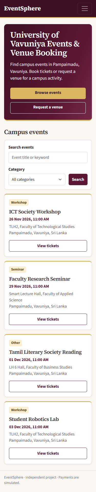

</details>

<details>
<summary>Attendee booking, waitlist, and venue hire</summary>

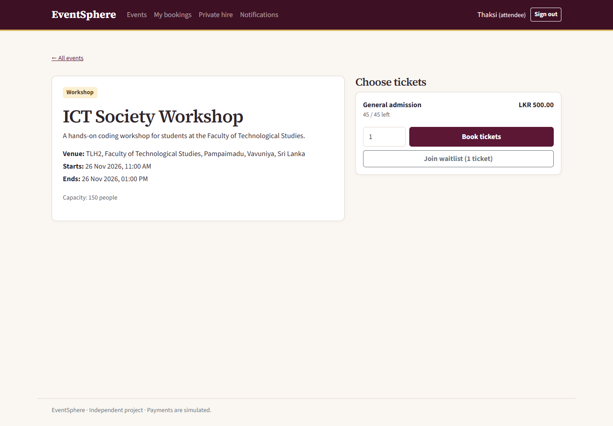

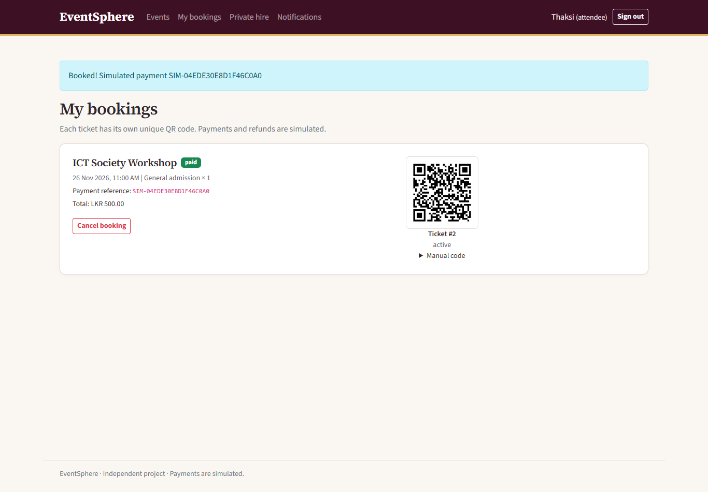

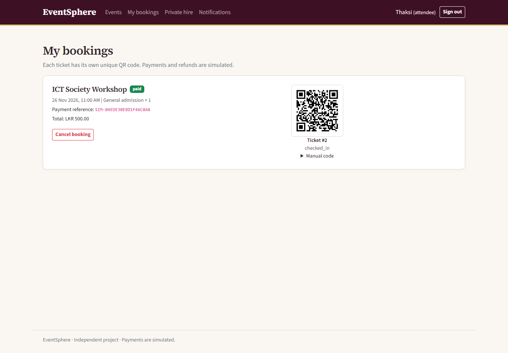

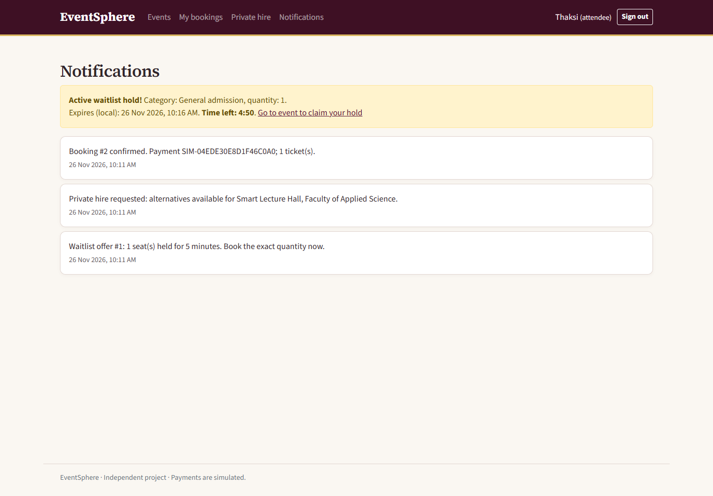

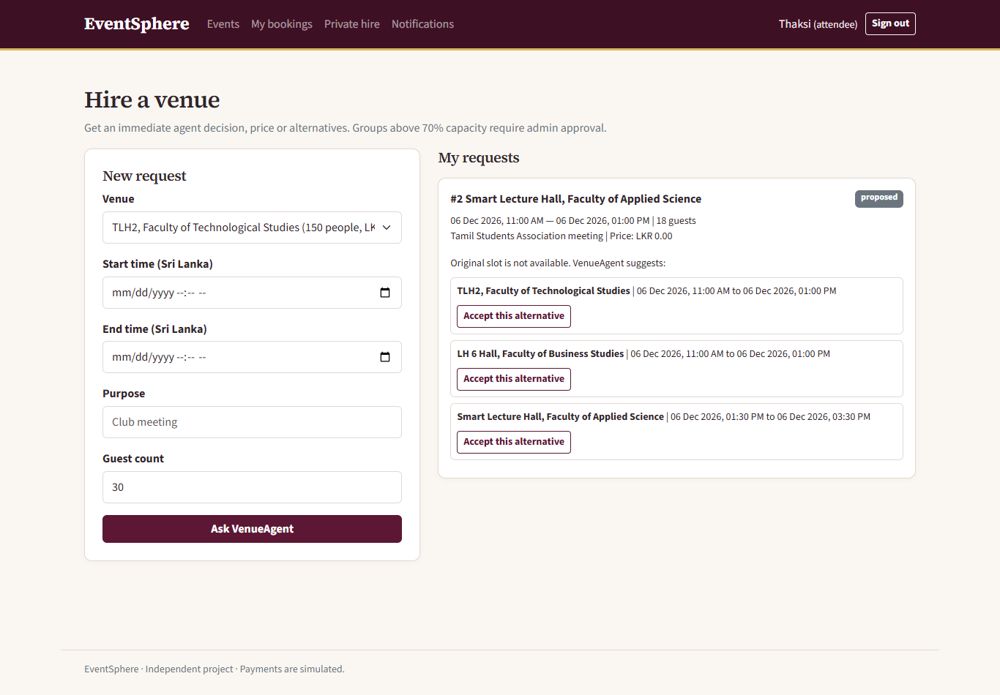

</details>

<details>
<summary>Staff check-in</summary>

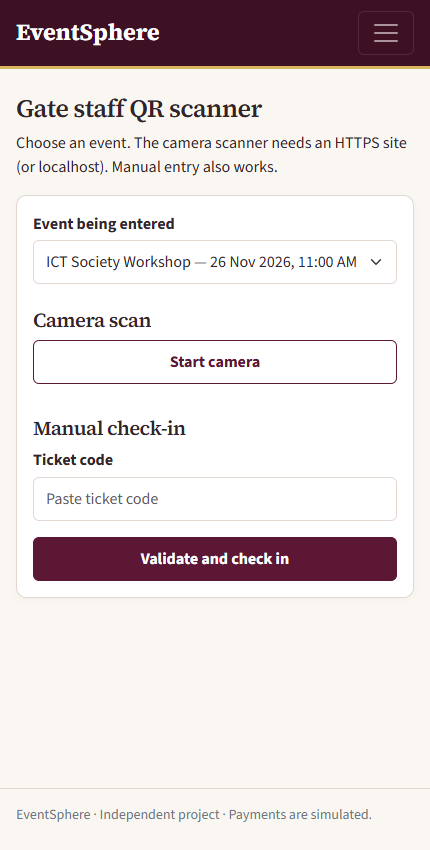

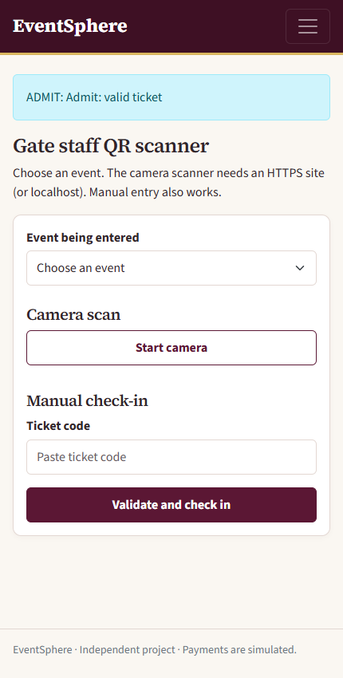

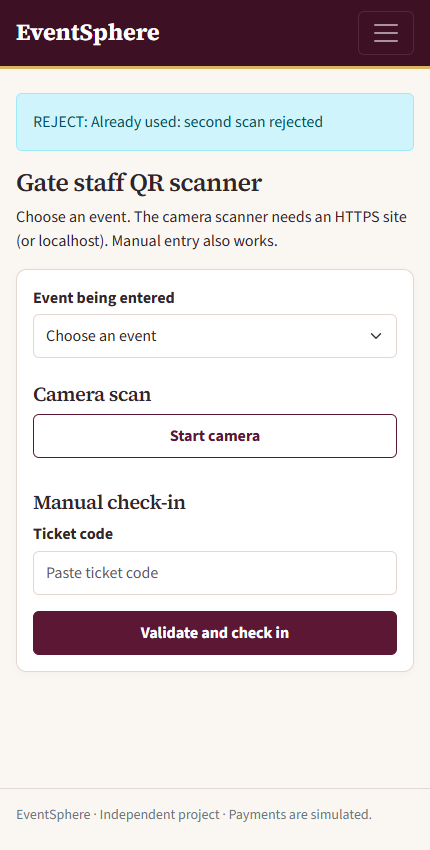

</details>

<details>
<summary>Admin dashboard, events, and venues</summary>

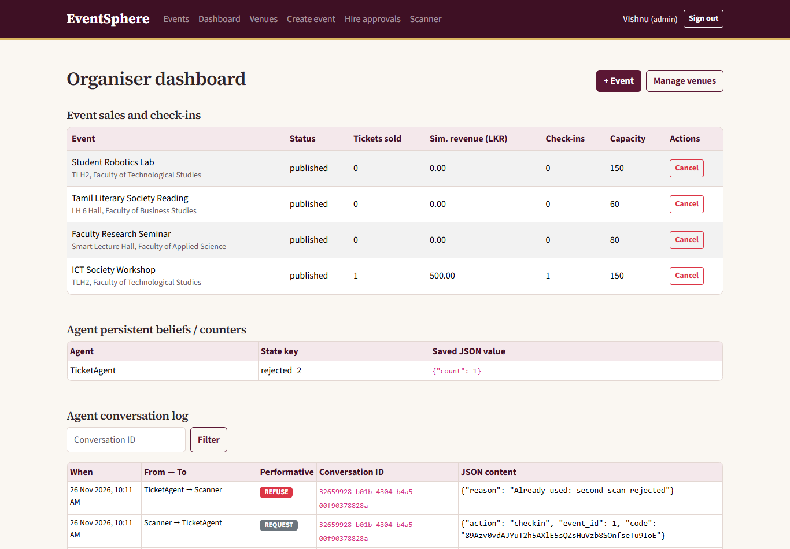

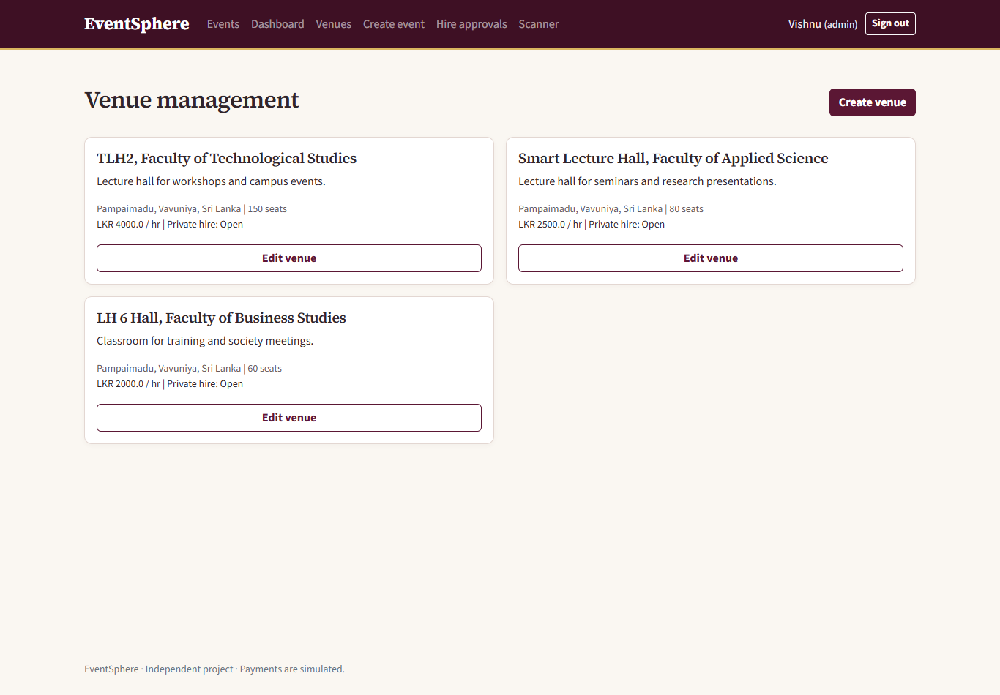

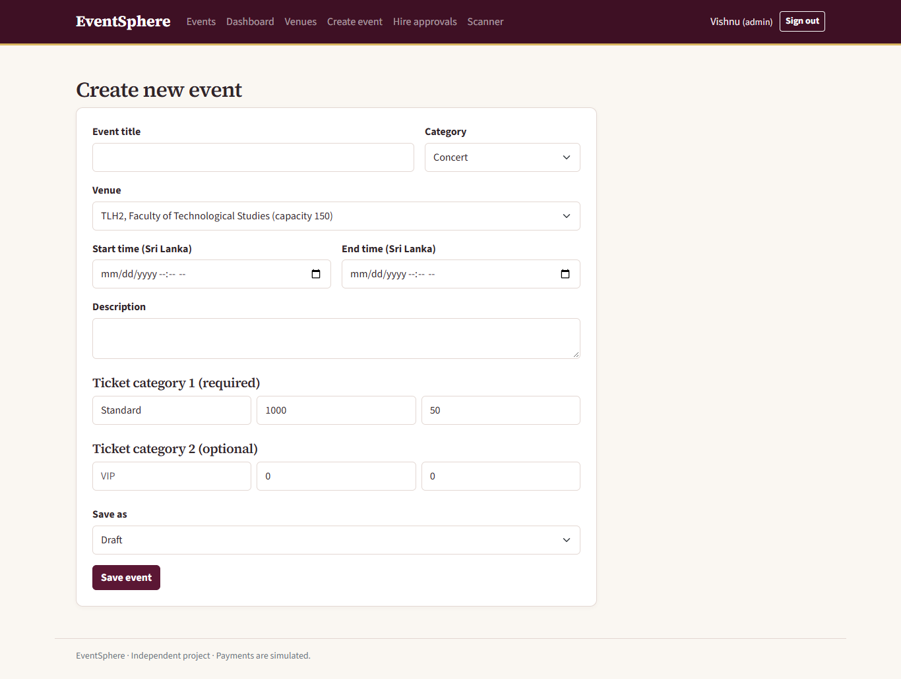

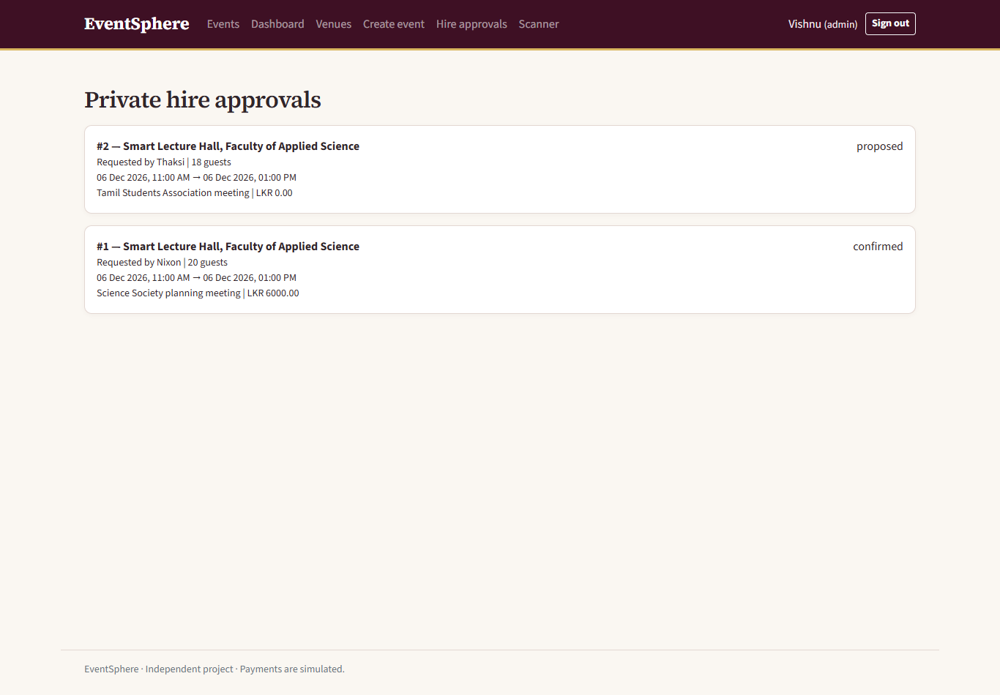

</details>

## Quickest Windows method

Open the project folder, double-click **`setup_windows.bat`**, then **`run_windows.bat`**. The scripts run the setup and startup commands below.

## Quick start – Windows PowerShell

```powershell
# Open PowerShell or VS Code Terminal in this folder
py -3.11 --version
py -3.11 -m venv .venv
.\.venv\Scripts\Activate.ps1
python -m pip install --upgrade pip
python -m pip install -r requirements.txt
python seed.py --sample-data
python -m uvicorn main:app --reload
```

If `py -3.11` is unavailable but Python 3.11+ is installed as `python`, replace the first two commands with `python --version` and `python -m venv .venv`. If PowerShell blocks activation, run `Set-ExecutionPolicy -Scope Process Bypass` and retry; this affects only the current PowerShell process.

Open <http://127.0.0.1:8000>. FastAPI API documentation: <http://127.0.0.1:8000/docs>. Stop the server with `Ctrl+C`.

### Initial accounts

| Role | Email |
|---|---|
| Admin | `admin@eventsphere.test` |
| Staff | `staff@eventsphere.test` |
| Attendee | `attendee@eventsphere.test` |

Local setup prompts for a password for each new account. You can also supply the initial passwords through environment variables. Existing accounts keep their current passwords. Run `python seed.py` without the optional `--sample-data` flag to create accounts only.

## Tests

```powershell
python -m pytest -v
```

The test suite covers the agents, concurrency, QR issuance and check-in, booking status, refunds, waitlist, notifications, venue capacity, agent logs, and permissions. See tests/.

## Files

| File / directory | Purpose |
|---|---|
| `main.py` | FastAPI routes, login, website, CSRF, startup and 30-second sweeper |
| `agents.py` | Five message-driven agents with independent documented rules |
| `models.py` | Relational database tables (persistent state) |
| `database.py` | SQLite local, PostgreSQL production connection |
| `security.py` | PBKDF2 hashed passwords, verification |
| `seed.py` | Create initial accounts and optional sample venues and events |
| `templates/` | HTML pages for attendees, staff, admin |
| `static/style.css` | Responsive design, 375px support |
| `tests/` | Pytest suite |
| `render.yaml` | Render Blueprint (FastAPI app + PostgreSQL) |
| `.env.example` | Sample environment-variable names; not loaded automatically |

## User workflows

1. **Admin:** Login, create/edit venue, create event (draft → publish), confirm conflict is refused, view dashboard/messages, approve hire.
2. **Attendee:** Search/filter events, book Standard or VIP tickets, view per-ticket QR, payment reference, cancellation/refund, join waitlist and private hire.
3. **Staff:** Open `/staff/scanner`, select event, scan phone QR or manually type code; test double scan and wrong event.
4. **Waitlist timer:** Sell out category, join queue, cancel someone's booking, see held seat/notification, wait 5 minutes; background sweep runs every 30 seconds to re-offer.

To verify booking and check-in together, create an event starting in one hour. Book a ticket before it starts. Staff can scan it as soon as the check-in window opens, two hours before the event starts.

## Agent decision rules

- **VenueAgent:** Checks ticket totals against current capacity before publishing. Uses a 30-minute gap between venue activities and proposes the earliest suitable slot in each eligible venue, up to three options. It calculates `hours × hourly_rate` and adds 20% on weekends (Asia/Colombo date). Requests above 70% capacity go to admin for approval.
- **BookingAgent:** At most 6 tickets per booking for a published event before its start. A conditional SQL update takes public stock only if enough remains. Booking, waitlist expiry, and cancellation lock the same event while changing its inventory. Payments use a `SIM-...` reference. Refunds are 100% at least 48 hours ahead, 50% from 24 to less than 48 hours, and 0% under 24 hours. Cancelling an event refunds all paid bookings in full.
- **TicketAgent:** `secrets.token_urlsafe(32)` per ticket; gates accept 2h before event start through event end, only for matching event, active ticket, active booking, and not scanned before. A conditional atomic SQL `UPDATE` guarantees single check-in.
- **WaitlistAgent:** First-come-first-served, 5-minute offers with a countdown in Notifications. The scheduler sweeps every 30 seconds, releases expired holds, and offers available inventory to the next eligible entry. An attendee can claim their hold from the event page even when public stock is zero. Cancelling the event closes its queue and releases its holds.
- **NotificationAgent:** Subscribes to broadcast `INFORM` messages and saves user notifications; reacts without being explicitly called by the UI.

Each exchanged message logs sender, receiver, performative, JSON content, conversation ID, and time. The admin dashboard can page through older messages or filter by conversation ID. State persists in PostgreSQL/SQLite tables (`agent_states`, `tickets`, `bookings`, `hire_requests`, `waitlist_entries`, `notifications`). Agents communicate through `MessageBus.send()`.

## Deployment to Render

1. Push this project to a **GitHub repository** without `.venv/`, `.env` or local `.db` files. `.gitignore` handles those.
2. Sign into Render; choose **New → Blueprint**, connect your GitHub repository, and use the included `render.yaml` to provision one web service and one PostgreSQL database. If Render cannot offer the requested free tier, choose an available supported plan/provider; fees and availability may change.
3. In the Render web service's **Environment**, set `SETUP_ACCOUNTS=1` and choose strong, unique passwords for `INITIAL_ADMIN_PASSWORD`, `INITIAL_STAFF_PASSWORD`, and `INITIAL_ATTENDEE_PASSWORD`. Save and deploy. The Blueprint generates `SECRET_KEY`, enables secure cookies, sets `APP_TIMEZONE=Asia/Colombo`, and links `DATABASE_URL` to PostgreSQL. Set `SEED_SAMPLE_DATA=1` only if you want sample venues and events on a fresh deployment.
4. The Blueprint runs `pip install -r requirements.txt` and starts Uvicorn with one worker so there is one waitlist scheduler.
5. Open the live HTTPS URL and verify `/healthz`, sign-in, venue and event creation, booking, QR check-in, and the agent log in `/admin`.

Render's published FastAPI deployment guide: <https://render.com/docs/deploy-fastapi>.

## Deployment details

- Notifications appear inside the website.
- The browser QR scanner needs `html5-qrcode` loaded from an external CDN and camera permission. **Manual entry fallback** works even if the library fails to load.
- Admins can supply an optional image URL for a venue.
